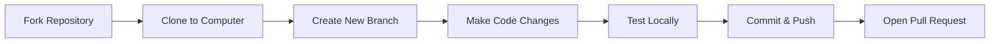

# Contributing to BPK Community Welfare Fund

Thank you for your interest in contributing to **BPK Community Welfare Fund**! Whether you are a beginner or an experienced developer, we welcome your contributions.

---

## 🌟 Beginner's Contribution Workflow

Here is how the contribution lifecycle works:



---

## 🛠️ Step-by-Step Guide

### Step 1: Fork and Clone
1. Click the **Fork** button on the top-right corner of the GitHub repository page.
2. Clone your personal fork to your local machine:
```bash
git clone https://github.com/YOUR-USERNAME/BPK_Community_Fund.git
cd BPK_Community_Fund
```

### Step 2: Create a Feature Branch
Always work on a separate branch rather than directly on `main`:
```bash
git checkout -b feature/your-feature-name
```
*Example:* `git checkout -b feature/receipt-download-fix`

### Step 3: Make Changes & Test
- Update frontend UI or backend API endpoints.
- Ensure the backend starts cleanly without syntax errors:
```bash
cd BackEnd
uvicorn main:app --reload
```

### Step 4: Commit Your Changes
Keep commit messages descriptive and clear:
```bash
git add .
git commit -m "feat: add PDF receipt generation for member contributions"
```

### Step 5: Push to GitHub
```bash
git push origin feature/your-feature-name
```

### Step 6: Create a Pull Request (PR)
1. Go to your repository on GitHub.
2. Click the green button: **Compare & pull request**.
3. Provide a clear description of the modifications you made.
4. Submit the pull request for review!

---

## 📋 Code Guidelines
- **Python**: Follow PEP 8 standards. Use meaningful variable and function names.
- **Frontend**: Keep HTML, CSS, and JavaScript cleanly formatted. Avoid hardcoding sensitive keys or URLs.
- **Security**: Never commit database passwords, API keys, or personal credentials. Always use `.env`.

---

Need help? Feel free to open an **Issue** on GitHub!
