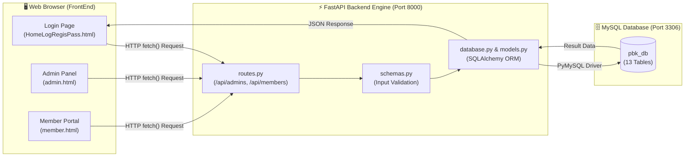
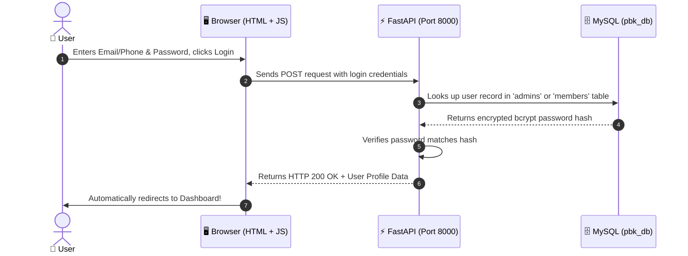

# 🗺️ BPK Community Fund — Visual Roadmap & System Architecture

> **Notice for Beginners:** This visual roadmap renders automatically on GitHub. You do **not** need to copy or paste any code from this page! Just follow the visual steps.

---

## 🎯 1. The 10-Step Setup Flowchart

```mermaid
flowchart TD
    Start(["🚀 START HERE"]) --> S1["1️⃣ Install Required Tools\n• Python 3.10+\n• MySQL 8.0\n• VS Code & Git"]
    
    S1 --> S2["2️⃣ Understand Folder Map\n• BackEnd (Python engine)\n• FrontEnd (3 HTML portals)"]
    
    S2 --> S3["3️⃣ Configure MySQL Password\n• Open BackEnd/database.py (Line 16)\n• Match your MySQL root password"]
    
    S3 --> S4["4️⃣ Setup Python Environment\n• python -m venv venv\n• Activate venv\n• pip install -r requirements.txt"]
    
    S4 --> S5["5️⃣ Create Database & 13 Tables\n• Run: python init_db.py\n• Auto-creates 'pbk_db' & Admin"]
    
    S5 --> S6["6️⃣ Start FastAPI Backend Engine\n• Run: uvicorn main:app --reload\n• Server active at port 8000"]
    
    S6 --> S7["7️⃣ Open Frontend Portals\n• HomeLogRegisPass.html (Login)\n• admin.html (Dashboard)\n• member.html (Receipts)"]
    
    S7 --> S8["8️⃣ End-to-End Live Testing\n• Test Member Registration\n• Test Admin Sign-in\n• Test Donation & PDF Receipt"]
    
    S8 --> S9["9️⃣ Check GitHub Security Rules\n• .gitignore blocks venv & .env\n• Only source code is pushed"]
    
    S9 --> S10["🔟 Push Project to GitHub\n• git init & git add .\n• git commit & git push"]
    
    S10 --> Finish(["🎉 100% COMPLETE & LIVE!"])

    style Start fill:#1e40af,stroke:#60a5fa,stroke-width:3px,color:#ffffff
    style S1 fill:#0f172a,stroke:#38bdf8,stroke-width:2px,color:#f8fafc
    style S2 fill:#0f172a,stroke:#818cf8,stroke-width:2px,color:#f8fafc
    style S3 fill:#0f172a,stroke:#fbbf24,stroke-width:2px,color:#f8fafc
    style S4 fill:#0f172a,stroke:#f87171,stroke-width:2px,color:#f8fafc
    style S5 fill:#0f172a,stroke:#fb923c,stroke-width:2px,color:#f8fafc
    style S6 fill:#0f172a,stroke:#34d399,stroke-width:2px,color:#f8fafc
    style S7 fill:#0f172a,stroke:#2dd4bf,stroke-width:2px,color:#f8fafc
    style S8 fill:#0f172a,stroke:#c084fc,stroke-width:2px,color:#f8fafc
    style S9 fill:#0f172a,stroke:#facc15,stroke-width:2px,color:#f8fafc
    style S10 fill:#0f172a,stroke:#22d3ee,stroke-width:2px,color:#f8fafc
    style Finish fill:#047857,stroke:#34d399,stroke-width:3px,color:#ffffff
```

---

## 🔄 2. How the Whole Website Connects (Data Flow)

---

## ⚡ 3. What Happens When a User Clicks "Login"

---

## 📖 Where to Go From Here
* To follow the complete text instructions step-by-step, open 👉 **[BEGINNER_GUIDE.md](BEGINNER_GUIDE.md)**
* To return to the project home page, open 👉 **[README.md](README.md)**
