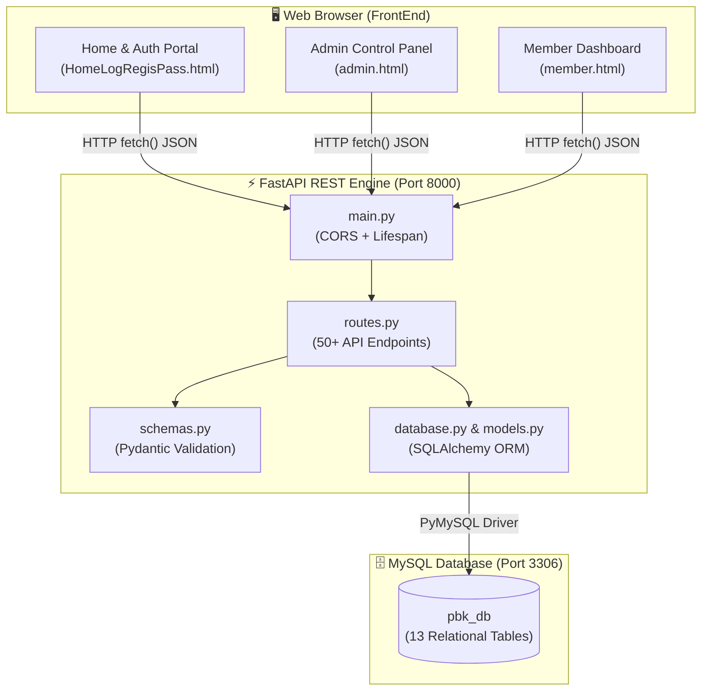

# 🌟 PBK Community Welfare Fund — Full-Stack Management System

[](https://fastapi.tiangolo.com)
[](https://www.python.org/)
[](https://www.mysql.com/)
[](LICENSE)

A comprehensive Full-Stack Community Welfare Fund Management Portal built with **FastAPI**, **SQLAlchemy ORM**, **MySQL 8.0**, and **Vanilla HTML5/CSS3/JavaScript**.

---

## 🚀 Quick Start (In 3 Commands)

```powershell
# 1. Activate BackEnd Virtual Environment
cd BackEnd
.\venv\Scripts\Activate.ps1

# 2. Start Backend API Server
uvicorn main:app --reload --host 127.0.0.1 --port 8000
```
- **Live API:** `http://127.0.0.1:8000/`
- **Interactive Swagger Docs:** `http://127.0.0.1:8000/docs`

```powershell
# 3. Open FrontEnd Portal
# Double click FrontEnd/HomeLogRegisPass/HomeLogRegisPass.html
```

---

## 📘 Documentation & Visual Roadmap
- 📖 **Full Handbook:** 👉 **[BEGINNER_GUIDE.md](BEGINNER_GUIDE.md)** *(Complete step-by-step tutorial)*
- 🗺️ **Visual Flowchart:** 👉 **[FLOWCHART.md](FLOWCHART.md)** *(Pure visual diagram view — no confusing code)*

---

## 🏛️ System Architecture



---

## 📂 Project Organization

```text
BPK_Community_Fund/
├── BackEnd/                         # Python FastAPI API & Database Engine
│   ├── database.py                  # MySQL connection settings
│   ├── database.sql                 # MySQL schema script
│   ├── init_db.py                   # Automated database and table builder
│   ├── main.py                      # FastAPI server entry point
│   ├── models.py                    # 13 SQLAlchemy ORM models
│   ├── routes.py                    # API route controllers
│   ├── schemas.py                   # Pydantic schemas
│   └── requirements.txt             # Python dependencies
│
├── FrontEnd/                        # Client Portals (HTML, CSS, JS)
│   ├── HomeLogRegisPass/            # Login, Registration & OTP
│   ├── Admin/                       # Admin management portal
│   └── Members/                     # Member dashboard & receipts
│
├── .gitignore                       # Repository shielding rules
├── BEGINNER_GUIDE.md                # 10-step master beginner guide
└── README.md                        # Project documentation
```

---

## 🔑 Default Credentials

- **Super Admin Email:** `admin@pbkfund.org` *(or `sai@gmail.com`)*
- **Super Admin Password:** `admin`
- **Default Database Name:** `pbk_db`

---

## 📄 License
This project is licensed under the MIT License.
